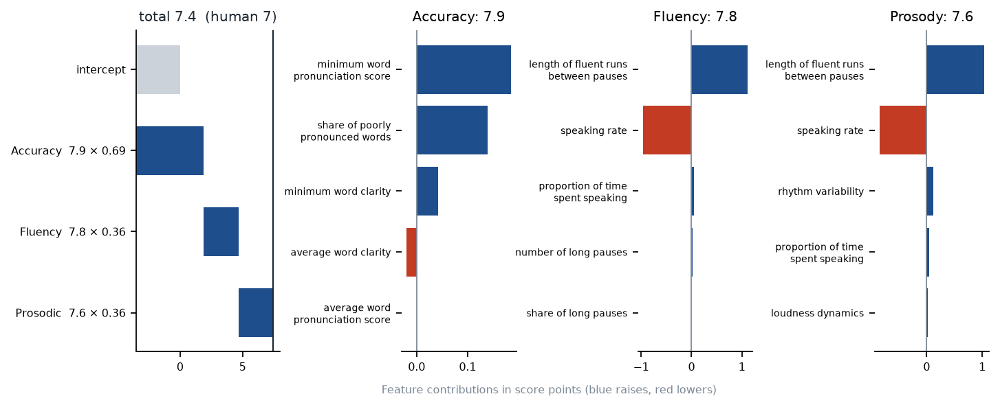
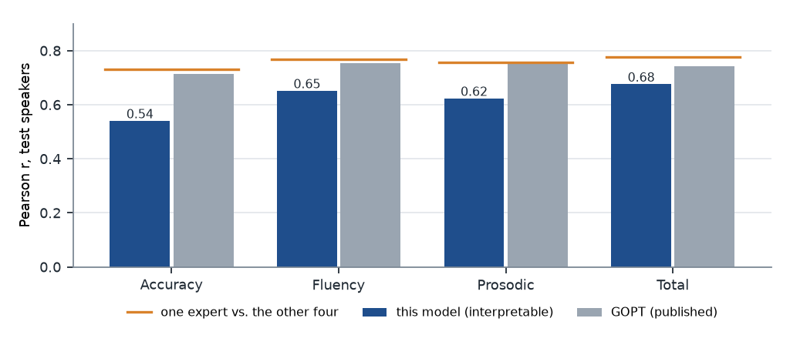
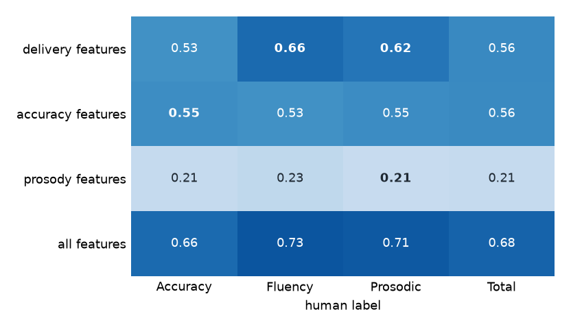
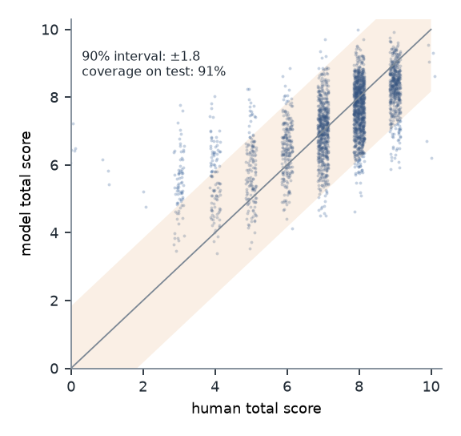
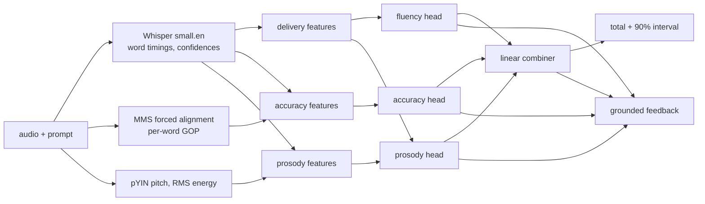

# speech-proficiency-scoring

[](https://github.com/jobarber/speech-proficiency-scoring/actions/workflows/ci.yml)

Explainable scoring of read-aloud English. Audio and the prompt go in; accuracy, fluency, prosody
and total scores come out, with a 90% interval, a reliability flag, and feedback that cites the
evidence behind each score.

The score is built from 45 named measurements (speech rate, pause structure, pronunciation
alignment scores, pitch range, and so on) rather than from a black-box embedding. Each analytic score
is produced by its own small model that can only see the evidence its rubric describes, so an explanation
like "your fluency score is low because of long mid-sentence pauses" is a description of the actual
computation, not a post-hoc story.



## Results

speechocean762 (5,000 sentences from 250 Mandarin-L1 children and adults, five expert raters).
All numbers are on the 125 held-out test speakers. Hyperparameters were chosen with speaker-grouped
cross-validation on the training speakers only.



The shipped model reaches r = 0.68 on the total score. That is within the confidence
interval of an unconstrained ridge on all features and close to gradient boosting (0.70), so the
interpretable structure costs little. It sits below GOPT (0.74), a transformer over phone-level
features, and below a single expert's agreement with the other four (0.78). The largest gap
is accuracy (0.54 vs. 0.71): word-level alignment scores are a coarse pronunciation
signal compared with phone-level GOP.

| Model (total score) | Pearson r [95% CI, speaker bootstrap] | QWK |
|---|---|---|
| Speech rate only | 0.394 [0.30, 0.48] | 0.266 |
| Ridge, all features | 0.680 [0.61, 0.73] | 0.640 |
| Gradient boosting, all features | 0.697 [0.63, 0.75] | 0.643 |
| **Multi-head (shipped)** | 0.676 [0.61, 0.73] | 0.636 |

## Does each head measure what it claims to?

Each feature group alone, fit to each human score. If the design is right, the strongest cell in
each column should sit on the matching row (bold).



Two things show up. Timing features predict *every* human score well (0.53 to 0.66), because
the four scores are strongly correlated in this corpus. And pitch and energy features alone barely
predict the prosody score (0.21), while timing features predict it at 0.62. That matches the corpus
rubric, which defines prosody as intonation *and* stable speed, cadence, stammering and pauses, so
the prosody head is given both feature groups. With pitch and energy only, it reached r = 0.21;
with both groups, it reaches 0.62.

Every head is also **sign-constrained**: a feature the rubric says should lower a score (pauses,
reading errors, low alignment scores) can only lower it. Without this, correlated features such
as speaking rate and articulation rate took opposite signs and produced explanations that
contradicted themselves. The constraint did not cost accuracy (total r 0.671 unconstrained,
0.676 constrained).

## Calibrated uncertainty

The interval half-width is the 90th percentile of absolute residuals from speaker-grouped
out-of-fold predictions on the training speakers (split conformal). It is then checked on the
test speakers:



Coverage of the nominal 90% interval on the test speakers is 90.8%.

## Children

**Children are scored less accurately than adults.** On the test speakers, correlation with the
human total is 0.82 for adults (16+) and 0.46 for children, and the model under-scores children by
0.21 SD while over-scoring adults by 0.22 SD. Gender differences are small (|SMD| < 0.05).

The cause is visible in the training data. Children receive *higher* human scores than adults
(accuracy 8.2 vs. 7.2) but *lower* acoustic scores (mean alignment score 0.61 vs. 0.66, slower
speech). Raters appear to judge children against age-appropriate expectations, while the acoustic
models, trained largely on adult speech, hear children's voices as less clear. A system for young learners would need child-speech
acoustic models or age-specific calibration. This one should not be used to score children as is.

## Pipeline



| Stage | Module |
|---|---|
| Whisper word timings and confidences | `asr.py`, `recording.py` |
| Delivery: speech and articulation rate, pauses, runs, repetitions | `features/delivery.py` |
| Accuracy: WER against the prompt, recognizer confidence, forced-alignment GOP | `features/accuracy.py`, `features/gop.py` |
| Prosody: pitch range in semitones, energy dynamics, rhythm (nPVI), pause placement | `features/prosody.py` |
| Sign-constrained ridge heads, non-negative linear combiner | `scoring/models.py` |
| Speaker-grouped CV, conformal intervals, reliability flags | `scoring/cv.py`, `scoring/confidence.py` |
| Feedback from the model's own contributions (optional LLM rephrasing) | `feedback/` |

Pitch features are relative to each speaker's own median F0, so the model cannot use voice pitch
(and with it age or gender) as a shortcut.

## Quick start

```bash
uv sync --extra cu128            # or --extra cpu
uv run speech-score download     # speechocean762, ~520 MB
uv run speech-score extract      # Whisper + alignment on GPU, then features on CPU
uv run speech-score evaluate     # results + figures
uv run speech-score train
uv run speech-score predict --audio data/speechocean762/WAVE/SPEAKER0003/000030024.WAV --prompt "Kate loves China"
```

`predict` prints JSON (the human raters gave this clip a total of 7):

```json
{
  "total": 7.43,
  "interval_90": [5.6, 9.26],
  "subscores": {"accuracy": 7.87, "fluency": 7.81, "prosodic": 7.55},
  "reliability": "high",
  "reliability_reasons": [],
  "feedback": "Total score: **7.4/10** (good). Your strongest area is **Accuracy**, helped by a good minimum word pronunciation score and a low share of poorly pronounced words. The biggest opportunity is **Fluency**, held back by a low speaking rate and a low articulation rate."
}
```

`outputs/features.parquet` is committed, so after `download` the base install (`uv sync`, no
torch) can run `evaluate`, `train` and `explain` on CPU. Only `extract` and `predict` need the
audio models.

Set `ANTHROPIC_API_KEY` in `.env` (see `.env.example`) to have Claude rephrase the template feedback.
The rephrasing is told to keep the score and cite only the evidence it is given.

## Limitations

- One corpus, one L1 (Mandarin), read speech only. Nothing here has been tested on other L1s or on
  spontaneous speech.
- GOP here is word-level and uses a multilingual alignment model. Phone-level GOP against a
  pronunciation lexicon is the obvious next step for the accuracy head.
- The reliability flag is rule-based. It catches silence, very short responses and off-prompt
  reading, but it is not a trained out-of-distribution detector.

## Data

Zhang et al., *speechocean762: An Open-Source Non-native English Speech Corpus for Pronunciation
Assessment*, Interspeech 2021. CC BY 4.0. GOPT reference numbers: Gong et al., *Transformer-Based
Multi-Aspect Multi-Granularity Non-Native English Speaker Pronunciation Assessment*, ICASSP 2022.

---

Developed with AI coding assistance (Claude Code). The design decisions, experiments and analysis are mine.
